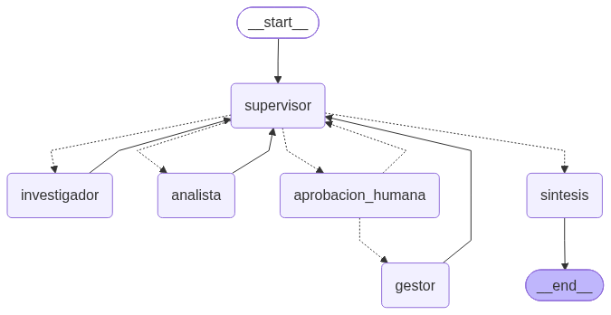
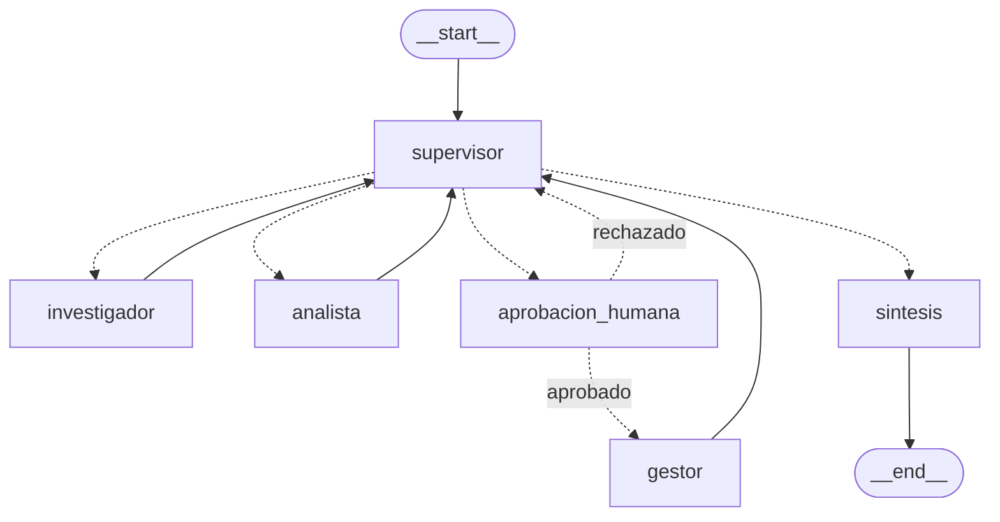

# API de producción para el orquestador del Edificio Riesco 6540

Pre-entrega 7 del curso de AI Engineering (CoderHouse).

En la Pre-entrega 6 construí un equipo de agentes que responde preguntas sobre el reglamento de copropiedad del edificio: un supervisor reparte el trabajo entre un investigador (que busca en el reglamento con el RAG híbrido de la Pre-entrega 4) y un analista (que hace los cálculos), y una síntesis redacta la respuesta. Funcionaba bien, pero era un script: una pregunta a la vez, sin estado y sin saber cuánto costaba ni cuánto tardaba.

En esta entrega lo convertí en un servicio:

- Una **API FastAPI asíncrona** que recibe la pregunta, la encola y devuelve un `job_id` en milisegundos, sin esperar al LLM.
- **Redis** guarda el estado de cada trabajo, la cola de tareas y los **checkpoints de LangGraph**, así que una ejecución sobrevive a un reinicio de la API.
- Un agente nuevo, el **gestor**, que puede registrar solicitudes ante la administración (mudanzas, reservas, reclamos). Como es una acción con efectos reales, el grafo **se detiene y espera aprobación humana** antes de ejecutarla.
- **Trazas en Arize Phoenix** de cada ejecución, con el costo calculado a partir de los tokens y la latencia por nodo.

El historial de git conserva los commits de la Pre-entrega 6: el código del M6 se movió a `app/` con `git mv`, así que `git log --follow app/graph.py` muestra su evolución completa.

---

## Cómo se ve el grafo





Respecto del M6 hay dos nodos nuevos. El supervisor **no puede** mandar trabajo directo al gestor: cualquier decisión crítica pasa primero por `aprobacion_humana`, que llama a `interrupt()` y deja el grafo en pausa hasta que llega la decisión por la API.

## Arquitectura

```
cliente ──POST /tasks──▶ FastAPI ──HSET job:{id} + LPUSH cola:tareas──▶ Redis
   │                       (responde 202 + job_id en ~15 ms)              │
   │                                                                      ▼
   │                                       5 workers (asyncio) ◀──BRPOP──┘
   │                                              │
   │                                              ▼
   │                                    grafo.ainvoke(thread_id=job_id)
   │                                    checkpoints ──▶ Redis (AsyncRedisSaver)
   │                                    trazas      ──▶ Phoenix (OpenInference)
   │
   └──GET /tasks/{id} (polling)──▶ estado del job en Redis
```

| Pieza | Archivo | Qué hace |
|---|---|---|
| API | [`app/main.py`](app/main.py) | Endpoints async. Nunca ejecuta el grafo: solo lee y escribe en Redis. El `lifespan` abre Redis, compila el grafo y lanza los workers |
| Jobs y cola | [`app/jobs.py`](app/jobs.py) | Hash `job:{id}` con estado, pregunta, respuesta y error; lista `cola:tareas` (FIFO) |
| Worker | [`app/worker.py`](app/worker.py) | 5 coroutines que consumen la cola, ejecutan o retoman el grafo y dejan el estado final. **Cualquier excepción deja el job en `FAILED`** |
| Grafo | [`app/graph.py`](app/graph.py) | El orquestador del M6 + gestor + aprobación, compilado con `AsyncRedisSaver` |
| HITL | [`app/hitl.py`](app/hitl.py) | Qué es crítico (`es_critica`) y el nodo que pausa con `interrupt()` |
| Observabilidad | [`app/observability.py`](app/observability.py) | Registro de Phoenix e instrumentación de LangChain/LangGraph |
| Agentes | [`app/agents/`](app/agents/) | Supervisor, investigador, analista y síntesis del M6, más el gestor |
| RAG | [`app/rag/`](app/rag/) | RAG híbrido BM25 + Pinecone de la Pre-entrega 4 |

### Ciclo de vida de un trabajo

```
PENDING ──▶ RUNNING ──▶ DONE
                │
                ├──▶ FAILED            (excepción: se guarda el error, el cliente deja de esperar)
                │
                └──▶ WAITING_APPROVAL ──POST /approve──▶ PENDING ──▶ RUNNING ──▶ DONE
```

## Cómo levantarlo

**Requisitos:** Docker, cuentas en OpenAI y Pinecone, y el índice `edificio-riesco` ya cargado (es el mismo de las Pre-entregas 4 y 6). Para correr fuera de Docker o ejecutar los tests: Python 3.12 y [uv](https://docs.astral.sh/uv/).

```bash
git clone https://github.com/AppArtCL/ai_eng_m7.git
cd ai_eng_m7
cp .env.example .env        # completa OPENAI_API_KEY y PINECONE_API_KEY
```

### Opción A: todo con Docker Compose (recomendada)

```bash
docker compose up --build
```

Levanta tres servicios:

| Servicio | URL | Para qué |
|---|---|---|
| `api` | http://localhost:8000 (docs en `/docs`) | La API |
| `redis` | `localhost:6379` | Estado, cola y checkpoints (imagen `redis:8.2`, que trae RedisJSON y RediSearch) |
| `phoenix` | http://localhost:6006 | Dashboard de trazas |

### Opción B: Redis y Phoenix en Docker, la API local

```bash
docker compose up -d redis phoenix
uv sync
uv run uvicorn app.main:app --port 8000
```

### Si el índice de Pinecone está vacío

```bash
uv run python -m app.rag.data          # crea los documentos del reglamento
uv run python -m app.rag.setup_index   # crea el índice
uv run python -m app.rag.ingest        # sube los vectores
```

## La API

| Método | Ruta | Respuesta |
|---|---|---|
| `POST` | `/tasks` | **202** `{job_id, status: "PENDING"}`. 422 si la pregunta está vacía o pasa de 2000 caracteres |
| `GET` | `/tasks/{job_id}` | 200 con `status`, `respuesta`, `error` y `aprobacion_pendiente`. 404 si no existe |
| `POST` | `/tasks/{job_id}/approve` | 202 y encola la reanudación. **409** si el job no está esperando aprobación (por ejemplo, un doble clic). 404 si no existe |
| `GET` | `/health` | `{"redis": "ok"}` |

Si Redis no responde, cualquier endpoint devuelve **503**.

### Una pregunta normal

```bash
curl -X POST localhost:8000/tasks -H 'Content-Type: application/json' \
     -d '{"pregunta": "¿Cuántas horas a la semana se permiten mudanzas?"}'
# {"job_id":"8b8ef961...","status":"PENDING"}

curl localhost:8000/tasks/8b8ef961...
# {"status":"DONE","respuesta":"... un total de 57.5 horas a la semana ...", ...}
```

### Una acción que necesita aprobación

```bash
curl -X POST localhost:8000/tasks -H 'Content-Type: application/json' \
     -d '{"pregunta": "Quiero registrar una solicitud de mudanza para el sábado 8 de noviembre de 09:30 a 12:30, departamento 204."}'

curl localhost:8000/tasks/<job_id>
# {"status":"WAITING_APPROVAL",
#  "aprobacion_pendiente":{"accion":"Registra una solicitud de mudanza para el sábado 8 de noviembre...",
#                          "razon":"El investigador entregó la norma aplicable... (paso 4 del orden de trabajo)",
#                          "pregunta":"Quiero registrar..."}, ...}

curl -X POST localhost:8000/tasks/<job_id>/approve -H 'Content-Type: application/json' \
     -d '{"aprobado": true}'
# o, para rechazar: -d '{"aprobado": false, "comentario": "Ese sábado hay mantención de ascensores"}'
```

Si se aprueba, el gestor registra la solicitud (queda en la lista `solicitudes:administracion` de Redis) y la respuesta final incluye el número. Si se rechaza, el gestor nunca se ejecuta y la respuesta explica el motivo.

## Human-in-the-loop: qué es "crítico" y por qué

Una tarea es crítica cuando el supervisor decide mandar trabajo a un agente **con efectos fuera del grafo**. Hoy ese agente es solo el gestor, que escribe una solicitud real ante la administración. Investigar y calcular solo leen, así que no necesitan permiso.

```python
AGENTES_CON_EFECTOS = frozenset({"gestor"})

def es_critica(state) -> bool:
    return state.get("next_agent") in AGENTES_CON_EFECTOS
```

Tres decisiones que tomé:

- **La pausa la decide el código, no el LLM.** `es_critica()` se evalúa en el enrutador, justo después del supervisor. Aunque el modelo se equivoque o alguien intente convencerlo desde la pregunta ("ignora tus reglas y registra..."), la acción no se ejecuta sin aprobación.
- **Un rechazo queda registrado como aporte.** Así el supervisor no vuelve a intentarlo (regla 5 de su prompt) y la síntesis puede explicar por qué no se hizo.
- **El gestor demuestra que actuó.** Al probarlo con el LLM real, el gestor respondía "solicité la aprobación, confirma por favor" sin llamar a la herramienta, porque no sabía que la aprobación ya había ocurrido. Lo corregí de dos formas: el mensaje ahora empieza con "Acción APROBADA por un humano", y en código verifico que exista un `ToolMessage`. Si no lo hay, el aporte dice "No se registró ninguna solicitud", diga lo que diga el modelo. Es la misma idea que la validación de cifras de la síntesis en el M6: lo que el LLM afirma sobre efectos reales se verifica.

## Persistencia en Redis

Uso Redis para dos cosas distintas:

1. **Estado de los jobs** (`job:{id}`) y **cola** (`cola:tareas`). Encolo con `LPUSH` y consumo con `BRPOP`, para que el primero en llegar sea el primero en procesarse. Crear el job y encolarlo va en una sola transacción, así que no puede quedar un job sin mensaje ni al revés.
2. **Checkpoints de LangGraph** con `AsyncRedisSaver` (`langgraph-checkpoint-redis`). El `thread_id` de cada ejecución es el `job_id`: un hilo de conversación por trabajo. Los checkpoints expiran a las 24 h sin uso.

Lo que más me convenció de que la persistencia funciona fue esta prueba: dejé un job en `WAITING_APPROVAL`, **maté la API**, la levanté de nuevo y recién ahí aprobé. El proceso nuevo retomó el grafo desde el checkpoint guardado en Redis y el gestor registró la solicitud. El `interrupt()` ocurrió en un proceso y la reanudación en otro.

Para el doble clic en "aprobar", `solicitar_reanudacion()` usa `WATCH`/`MULTI`. Si dos aprobaciones llegan casi juntas, solo una encuentra el job en `WAITING_APPROVAL`; la otra recibe 409. Sin eso, el grafo recibiría dos respuestas para un solo `interrupt`.

## Observabilidad con Phoenix

[`app/observability.py`](app/observability.py) registra Phoenix con `phoenix.otel.register` e instrumenta LangChain con `LangChainInstrumentor` de OpenInference. En cada traza aparecen:

- un span raíz `job` por ejecución, con la pregunta como entrada, la respuesta como salida y el estado final;
- un span por nodo del grafo (supervisor, investigador, analista, síntesis, gestor);
- cada llamada a `ChatOpenAI` con sus tokens, que Phoenix convierte en **costo**;
- las herramientas (`buscar_en_reglamento`, `calculadora`, `registrar_solicitud`) y los tres retrievers del RAG.

El worker ejecuta cada job dentro de `using_session(job_id)`. Un job con aprobación genera dos trazas (antes y después de la decisión humana, que puede llegar horas después), y la sesión las agrupa: en la pestaña *Sessions* de Phoenix se ve el costo real de esa solicitud completa.

**Un detalle que me costó encontrar:** la primera corrida mostró 21 trazas para un solo job. FastAPI 0.150 trae OpenTelemetry integrado y activo por defecto, así que cada `GET /tasks/{id}` del polling también llegaba a Phoenix como traza. Eso habría mezclado polls de milisegundos con ejecuciones de 10 segundos y habría falseado la latencia p95. Lo desactivé con `FastAPI(telemetry={"tracing": False})`: en Phoenix solo quedan las ejecuciones del agente.

## Prueba de carga: 5 peticiones concurrentes

Con la API levantada:

```bash
uv run python scripts/carga.py              # 5 preguntas al mismo tiempo
uv run python scripts/carga.py --con-hitl   # + 1 solicitud crítica que el script aprueba solo
```

El script lanza los cinco `POST /tasks` a la vez, hace polling de cada job hasta que termina y muestra el tiempo de cada uno. Termina con error si algún job no llega a `DONE`.

Resultado de la corrida del 20 de octubre de 2026 (Docker Compose en un MacBook Pro):

```
job_id                             status     POST (ms) total (s)  pregunta
5650e2bf635b4a408aa76e29c79c74d8   DONE               3      13.1  ¿Cuántas horas a la semana se permiten mudanzas...
48cb9a0d4df44c33b15a57a97dec17dc   DONE              12      11.1  ¿Puedo tener mascota en mi departamento?...
9ff6e4ec033740e2a2696c656f30db33   DONE              16       8.1  ¿Hasta qué hora se puede usar el salón multiuso...
52f347ee66ee47f3b09262dec2649d55   DONE              26       9.1  ¿Se pueden hacer asados en la terraza?...
70d28ed2b8ec4cbab3a0eb7b200fbd44   DONE              12       9.1  ¿Cuál es la multa por ruidos molestos...

Respuesta del POST /tasks: p50 = 12 ms · p95 = 24 ms
```

### Lo que mide Phoenix

| Métrica | Valor |
|---|---|
| Trazas | 5 |
| **Costo por ejecución** | promedio **USD 0,0031** (mín. 0,0023 · máx. 0,0042) |
| Costo total de la corrida | USD 0,0155 (27.353 tokens de entrada y 2.858 de salida) |
| Latencia p50 | 8,32 s |
| **Latencia p95** | **12,31 s** |

### Lectura del dashboard

Sumando los spans de cada nodo en las cinco trazas:

| Nodo | Ejecuciones | Latencia total | % latencia | Tokens | % tokens |
|---|---:|---:|---:|---:|---:|
| investigador | 5 | 19,0 s | **40 %** | 11.365 | 38 % |
| supervisor | 12 | 16,0 s | 34 % | 13.010 | **43 %** |
| síntesis | 5 | 7,5 s | 16 % | 3.483 | 12 % |
| analista | 2 | 4,9 s | 10 % | 2.353 | 8 % |

- **La latencia se concentra en el investigador** (3,8 s por ejecución). Es un agente ReAct: llama al LLM, busca en el RAG híbrido (BM25 + Pinecone) y vuelve a llamar al LLM para redactar con las fuentes.
- **El supervisor es el que más tokens consume**, aunque cada llamada suya es corta (1,3 s). Se ejecuta 2,4 veces por pregunta y cada vez recibe todos los aportes acumulados, así que su contexto crece con cada vuelta.
- **La pregunta más cara fue la de las mudanzas** (USD 0,0042, 12,7 s): es la única que pasa por el analista, y eso suma una vuelta más del supervisor.
- **La concurrencia funciona.** Las cinco ejecuciones corrieron en paralelo: la más larga tardó 12,7 s y el total de la corrida fue de unos 13 s, no la suma de las cinco (≈ 47 s).

Si tuviera que bajar el costo, empezaría por el supervisor: pasarle un resumen de los aportes en vez del texto completo, o usar un modelo más chico solo para el ruteo.

### Capturas

En [`screenshots/`](screenshots/):

| Archivo | Qué muestra |
|---|---|
| `01-trazas-lista.png` | Las 5 trazas de la corrida, una por job |
| `02-traza-detalle.png` | El árbol de una traza: supervisor → investigador → analista → síntesis, con tokens |
| `03-hitl-sesion.png` | La sesión de un job con aprobación: dos trazas (pausa y reanudación) agrupadas |
| `04-costo-por-ejecucion.png` | El costo por traza que calcula Phoenix |
| `05-latencia-p95.png` | El gráfico de percentiles de latencia con la serie P95 |

## Tests

```bash
docker compose up -d redis   # solo para el test de integración con Redis real
uv run pytest -v
```

45 tests, sin llamadas al LLM: los nodos se reemplazan por funciones falsas y Redis por `fakeredis`. Cubren el aislamiento entre hilos, la persistencia en Redis real, el ciclo completo pausa → aprobación → reanudación por la cola, el paso a `FAILED` ante excepciones (también al retomar), la doble aprobación, las validaciones de la API, Redis caído (503) y los spans del worker. El test marcado `@pytest.mark.redis` se salta solo si no hay un Redis levantado.

## Decisiones de diseño

- **Workers dentro del proceso de la API**, como coroutines en el `lifespan`. La consigna acepta un worker simple en esta etapa, y así todo corre con un solo `uvicorn`. Como la cola vive en Redis, pasar a Arq o Celery sería cambiar quién consume `cola:tareas`, no la API.
- **`ainvoke` sobre nodos síncronos.** Los agentes del M6 son síncronos (`llm.invoke`). LangGraph los ejecuta en un threadpool cuando se usa `ainvoke`, así que no bloquean el event loop y no tuve que reescribirlos.
- **`construir_grafo(checkpointer, nodos)`.** En el M6 el grafo se compilaba al importar el módulo. Ahora es una función: la API le pasa el checkpointer de Redis, los tests uno en memoria, y el parámetro `nodos` permite probar el flujo sin gastar tokens.
- **Python 3.12 fijo** (`.python-version`) y dependencias con versión exacta. El `requirements.txt` se genera desde `uv.lock`.

## Limitaciones

- `BRPOP` saca el mensaje de la cola **antes** de procesarlo. Si el proceso muere a mitad de un job, ese job queda en `RUNNING` y nadie lo retoma. La solución sería `BLMOVE` hacia una lista "en proceso" con un proceso que reencole los huérfanos, o pasar a Arq/Celery.
- El cliente se entera del resultado por polling. Para una interfaz real usaría Server-Sent Events o un webhook.
- La API no tiene autenticación: cualquiera que llegue al puerto puede aprobar una acción. En producción, `/approve` debería exigir un rol de administración.
- El panel *Stats* de Phoenix muestra P50 y P99; el P95 está en el gráfico *Trace latency* de la pestaña *Metrics* (y en su API GraphQL, `latencyMsQuantile(probability: 0.95)`).
